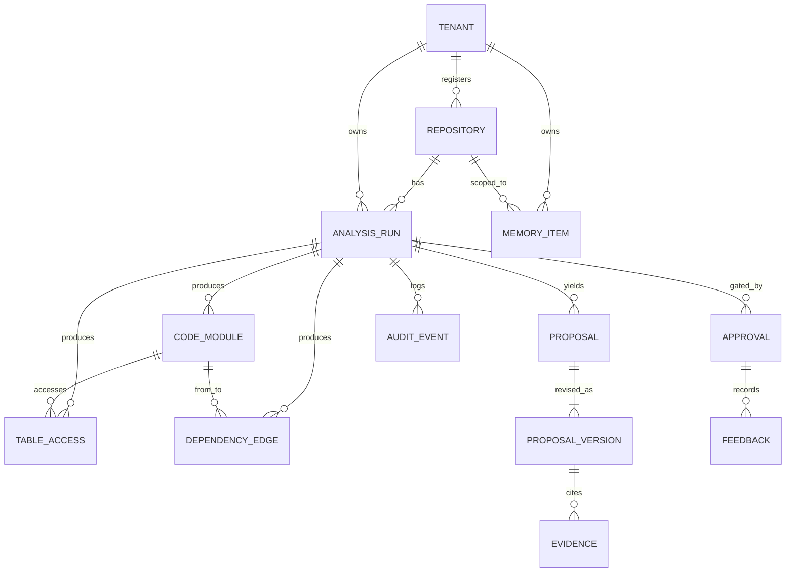

# Data Model: Agentic AI Migration Assistant

Companion to [tdd.md](tdd.md). Postgres is the single source of truth; Redis holds only rebuildable data; Blob holds large or immutable artifacts. No existing schema in the repo, so this is greenfield. The source design names tables and keys but not every column: columns below are derived from the described behavior and marked where inferred.

## Overview

Entities cover tenancy, run lifecycle, the normalized code model, proposals and evidence, approvals/feedback, audit, agent memory and LangGraph checkpoints.

## Entity-Relationship Diagram

## Entities

All tables carry `tenant_id uuid NOT NULL` with row-level security on it (omitted from the tables below for brevity unless noted). Primary keys are `uuid` unless noted. Column lists marked *(inferred)* are not given in the source.

### tenant
| Field | Type | Constraints | Notes |
| --- | --- | --- | --- |
| id | uuid | PK | |
| name | text | NOT NULL | *(inferred)* |
| monthly_token_cap | bigint | | Per-tenant cap; `NULL` = TBD default |
| run_token_budget | bigint | | Default per-run budget, configurable |

### repository
| Field | Type | Constraints | Notes |
| --- | --- | --- | --- |
| id | uuid | PK | |
| provider | text | `github`/`gitlab` | |
| url | text | NOT NULL | |
| protected | boolean | default false | Triggers four-eyes at Gate 2 |
| installation_ref | text | | GitHub App installation; no tokens stored |
| registered_by | text | | Admin identity |

### analysis_run
| Field | Type | Constraints | Notes |
| --- | --- | --- | --- |
| id | uuid | PK | = `run_id` across logs/traces/audit |
| repo_id | uuid | FK repository | |
| commit_sha | char(40) | NOT NULL | |
| status | text | state machine | e.g. queued, analyzing, proposing, awaiting_gate1, generating, awaiting_gate2, done, failed, needs_review (exact set TBD) |
| stage | text | | Current stage |
| version | int | NOT NULL | Optimistic locking |
| model_versions | jsonb | | Pinned LLM versions |
| prompt_version | text | | Registry version id |
| budget_tokens / budget_used | bigint | | Flushed from Redis at end |
| cost_usd | numeric | | |
| initiated_by | text | | For four-eyes check |
| created_at / finished_at | timestamptz | | |

Unique: one active run per `(repo_id, commit_sha)` (mirrors the Redis lock).

### code_module, table_access, dependency_edge
Partitioned by month; keyed `(run_id, ...)`; retention 12 months.

| Table | Fields (inferred) |
| --- | --- |
| code_module | `run_id`, `module_id`, `fqcn`, `file_path`, `stereotype` (controller/service/repository/entity/…), `loc`, `cluster_id` |
| table_access | `run_id`, `module_id` FK, `table_name`, `access_type` (read/write), `file_path`, `line` |
| dependency_edge | `run_id`, `from_module`, `to_module`, `kind` (call/injection/inheritance), `weight`, `change_coupling_score` |

### proposal, proposal_version, evidence
| Table | Fields |
| --- | --- |
| proposal | `id`, `run_id` FK, `status` (draft/verified/flagged/approved/rejected) |
| proposal_version | `proposal_id`, `version` int, PK `(run_id, version)`; `services jsonb` (services, module assignments, rationale), `violations jsonb`, `source` (agent round / human edit) |
| evidence | `id` (stable evidence id the output must cite), `proposal_version` FK, `kind` (file/line/metric/table), `ref`, `file_path`, `line`, `metric`, `supports_claim` |

### approval, feedback
Append-only; retained 7 years.

| Table | Fields |
| --- | --- |
| approval | `id`, `run_id`, `gate` (1/2), `decision` (approved/edited/rejected), `approver`, `reason`, `created_at` |
| feedback | `id`, `approval_id`, `edit_diff jsonb`, `reason`, `approver` |

### audit_event
Append-only, hash-chained, app role INSERT-only, partitioned monthly, retained 7 years.

| Field | Type | Notes |
| --- | --- | --- |
| id | bigserial | |
| run_id, tenant_id | uuid | |
| ts | timestamptz | |
| event_type | text | llm_call, tool_call, policy_decision, approval, pr_action, run_start |
| actor | text | User or agent |
| payload | jsonb | Model, prompt version, token counts, input/output hashes, OPA decision, etc. |
| prev_hash / hash | bytea | Chain; verified by chain-check job |

### memory_item (pgvector)
| Field | Type | Notes |
| --- | --- | --- |
| id | uuid | |
| tenant_id, repo_id | uuid | |
| kind | text | `code_chunk`, `summary`, `doc`, `adr`, `episode` |
| sha | char(40) | Null for episodes |
| content | text | |
| embedding | vector(N) | Dimension TBD, depends on embedding model |
| embedding_model_version | text | Nightly re-embed on change |
| provenance | jsonb | source run, SHA, approver, reason |
| tsv | tsvector | Full-text for keyword retrieval |
| expires_at | timestamptz | Per-SHA items pruned after 30 days |

### LangGraph checkpoints
Managed by the Postgres checkpointer, keyed `(thread_id, checkpoint_id)`; 90-day retention. `thread_id` = `run_id`.

## Non-relational stores

**Redis key families** (all TTL'd, prefix `t:{tenant}:`): `codemodel:{repo}:{sha}` (7 d, immutable), `llm:exact:{hash}` (24 h), `toolres:{run}:{tool}:{args_hash}` (run lifetime), `lock:run:{repo}:{sha}` (30 min, heartbeat), `rl:{tenant}` (rolling), `budget:{run}` (run lifetime), `session:{user}` (8 h).

**Blob layout:** `/{tenant}/{repo}/{sha}/` containing the snapshot tar (30 d), `code_model.json`, specs, plans, scaffolds (immutable 1 year).

**Service Bus:** queue per stage; sessions keyed by `run_id`; DLQ 14 days.

## Indexes

| Table | Columns | Type | Reason |
| --- | --- | --- | --- |
| analysis_run | `(tenant_id, repo_id, commit_sha)` | unique partial (active) | One active run per repo+SHA |
| analysis_run | `(tenant_id, status)` | btree | Dashboards, queue-like queries |
| code_module | `(run_id, fqcn)` | btree | Tool lookups |
| table_access | `(run_id, table_name)` | btree | Shared-table rule check |
| dependency_edge | `(run_id, from_module)`, `(run_id, to_module)` | btree | Neighborhood (2-hop) retrieval |
| proposal_version | `(run_id, version)` | PK | |
| evidence | `(proposal_version_id)` | btree | Validity checks |
| audit_event | `(run_id, ts)` | btree | Run explanation |
| memory_item | `embedding` | HNSW | Similarity |
| memory_item | `(tenant_id, repo_id, kind)` | btree | Namespace filter |
| memory_item | `tsv` | GIN | Exact class/table names |

## Migration Plan

Greenfield, so no backfill. Apply via versioned migrations (tool TBD, e.g. Alembic given the Python stack). Enable RLS policies and create the INSERT-only app role for `audit_event`/`approval`/`feedback` in the first migration. Monthly partitions created by a scheduled job. Nightly job prunes expired items and re-embeds on embedding-model change.

## Open Questions

- Embedding model and vector dimension — TBD
- Exact `analysis_run.status` state set — TBD, finalize with [lld.md](lld.md)
- Column-level details for code-model tables — inferred here; confirm after analyzer prototype
- Migration tool (Alembic vs other) — TBD
