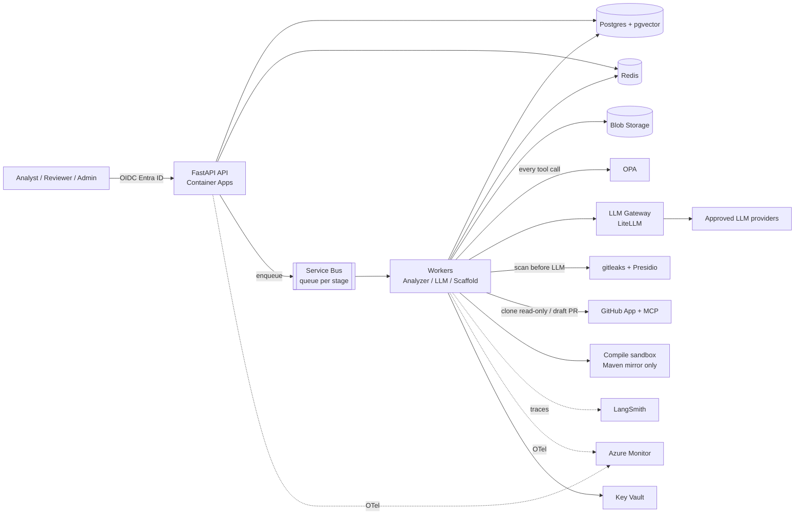
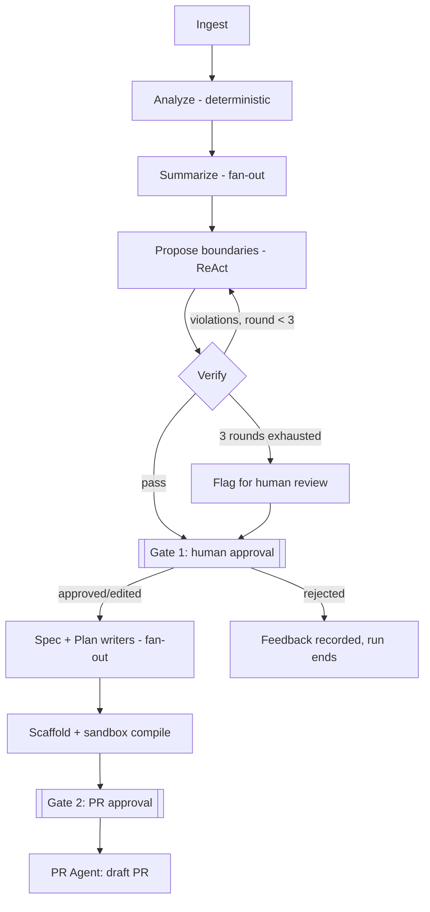

# HLD: Agentic AI Migration Assistant

Companion to [tdd.md](tdd.md). Service-level shape, integration points, failure domains and security boundaries.

## Overview

Users (analysts, reviewers, admins) interact with a stateless API. The API records runs in Postgres and enqueues work on Service Bus. Queue-driven workers execute a LangGraph pipeline (ingest, analyze, summarize, propose, verify, approve, generate, scaffold, PR). Workers call out only through the LLM gateway and GitHub, with OPA checking every tool call and every event written to an append-only audit log.

## System Context Diagram

## Run Pipeline

## Service Boundaries

| Service | Responsibility | Owns Data | Talks To |
| --- | --- | --- | --- |
| API | AuthN/Z, validation, run lifecycle, approvals | Session cache (Redis) | Postgres, Redis, Service Bus, Entra |
| Analyzer workers | Parse, graph, git mining, clustering | Code model (Blob + Postgres tables) | Blob, Postgres, Redis |
| LLM workers | Summarize, propose, verify critic, write specs/plans | Proposals, evidence | LLM gateway, Postgres, pgvector, OPA |
| Scaffold sandbox | Render templates, compile | Scaffold artifacts | Blob, Maven mirror only |
| PR Agent | Branch, commit, draft PR | PR records, audit | GitHub MCP, OPA |
| LLM gateway | Routing, fallback, budgets, key isolation | Call logs | Providers |
| Postgres | System of record | All relational state, checkpoints, memory | — |

## Integration Points

| From | To | Mechanism | Sync/Async | Notes |
| --- | --- | --- | --- | --- |
| Client | API | HTTPS + OIDC bearer | Sync | Rate limit `rl:{tenant}` |
| API | Workers | Service Bus queue per stage, sessions keyed by `run_id` | Async | At-least-once; idempotent on `(run_id, stage)` |
| Worker | LLM | Via LiteLLM gateway | Sync (async I/O) | Temp 0, pinned versions, fallback logged |
| Worker | GitHub | Clone (read-only token); MCP for PR | Sync | GitHub App installation tokens |
| Worker | Postgres | PgBouncer pooled | Sync | Optimistic locking on run `version` |
| Worker | Blob | Upload, then reference in Postgres | Sync | Reference written only after upload succeeds |
| Worker | OPA | Policy decision per tool call | Sync | Decisions logged to `audit_event` |
| API/Workers | Monitor / LangSmith | OTel / SDK | Async | Linked by `run_id` |

Human approvals are the intentional synchronization points: LangGraph interrupts persist state and the run resumes when an approval is POSTed.

## Deployment / Infra Topology

- Single Azure region, zone-redundant, v1. Environments: TBD.
- Container Apps: API (2–20 replicas), analyzer workers (0–50, CPU-heavy SKU), LLM workers (0–100, I/O-bound), compile sandbox as short-lived jobs with no network except a Maven mirror. KEDA scales on queue depth.
- Postgres Flexible Server with read replica for dashboards/eval; `audit_event` partitioned monthly.
- Redis vertical first, clustered later; keys already tenant-prefixed.
- DR: Postgres geo-backup and Blob geo-replication; RPO 1 h, RTO 4 h.

## Failure Modes & Resilience

| Failure | Behavior |
| --- | --- |
| Worker crash mid-stage | Resume from last LangGraph checkpoint; idempotent stage |
| Duplicate delivery | Harmless (idempotency on `(run_id, stage)`) |
| Poison message | DLQ after 5 attempts, alert |
| Redis lost | Rebuild from Postgres/Blob; locks reacquired; no correctness loss |
| LLM provider 429/5xx | Backoff + jitter, circuit breaker per provider, fallback model (flagged in results) |
| Stage timeout | Fails the step, not the run |
| Budget exhausted | Run stops, requests review; no silent degradation |
| Verifier loop not converging | Cap at 3 rounds, flag for human |
| Compile failure | Reported at Gate 2; no PR without approval |
| GitHub unavailable | PR stage retries; no duplicate PRs (idempotency per run) |

## Security Boundaries

- Trust zones: public API ingress; internal worker network; egress only to LLM gateway, GitHub, Maven mirror (sandbox).
- Identity: Entra ID for users (roles viewer/analyst/reviewer/admin); managed identities between services; secrets in Key Vault.
- Tenant isolation: `tenant_id` on every table with Postgres row-level security; Blob path prefix `/{tenant}/...`; Redis prefix `t:{tenant}:`.
- OPA: per-agent tool allowlists. Write tools exist only on PR Agent (create-branch, commit, open-draft-PR on registered repos). No merge, delete-branch, repo-setting changes or arbitrary egress.
- Prompt injection: repo content is untrusted data in delimited blocks; tool permissions don't depend on model output; outputs schema-validated.
- Data protection: gitleaks + Presidio before any LLM call; no-training and residency terms with providers; snapshots encrypted, deleted after 30 days.
- Audit: hash-chained `audit_event`, app role INSERT-only.
- Four-eyes: PR approver cannot be the run initiator on protected repos.

## Open Questions

- Environment topology (dev/stage/prod, regions) — TBD
- Approved LLM providers/regions for source code — TBD, pending bank data policy
- Network design (private endpoints, VNet) — TBD, not specified in source
