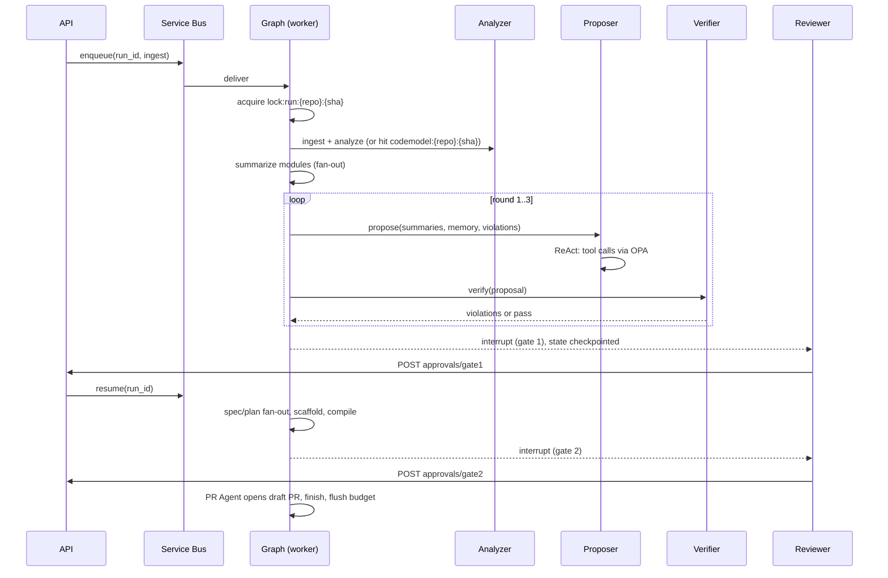

# LLD: Agentic AI Migration Assistant

Implements [tdd.md](tdd.md) and [hld.md](hld.md). Entities are owned by [data-model.md](data-model.md); endpoints by [api-spec.md](api-spec.md). Module names and signatures below are proposed (the source gives behavior, not code structure) and unverified until prototyped.

## Scope

The agent graph, node contracts, run state, code-model tooling, memory retrieval, the verifier, caching/budget/lock mechanics, and the policy layer. Python 3.12, mypy strict, Pydantic v2 at every boundary.

## Module Breakdown

| Module | Responsibility | Depends On |
| --- | --- | --- |
| `api/` | FastAPI routers, auth, schemas | `store`, `queue` |
| `graph/` | LangGraph definition, `RunState`, interrupts, routing | all nodes, `checkpoint` |
| `nodes/ingest` | Read-only clone at SHA, snapshot to Blob | `blobstore`, `github` |
| `nodes/analyze` | tree-sitter parse, PyDriller coupling, networkx graph, Louvain | `blobstore` |
| `nodes/summarize` | Per-module summary (fan-out) | `llm`, `scan` |
| `nodes/propose` | ReAct Boundary Proposer | `tools/codemodel`, `memory`, `llm` |
| `nodes/verify` | Rules engine + LLM critic | `rules`, `tools/codemodel`, `llm` |
| `nodes/gates` | Interrupt handlers for gate 1 and 2 | `store`, `memory` |
| `nodes/spec`, `nodes/plan` | Per-service OpenAPI/plan (fan-out) | `llm`, spec validator |
| `nodes/scaffold` | Template render, LLM fill, sandboxed compile | `sandbox` |
| `nodes/pr` | Branch, commit, draft PR via MCP | `github`, `policy` |
| `tools/codemodel` | Read-only query tools exposed to agents | code-model store |
| `memory/` | Hybrid retrieval, write policy | pgvector, Postgres |
| `llm/` | Gateway client: budget check, cache, retries, schema parse | Redis, LiteLLM |
| `scan/` | gitleaks + Presidio masking | — |
| `policy/` | OPA client; wraps every tool call | OPA |
| `audit/` | Hash-chained writer | Postgres |
| `rules/` | Hard verification rules (pure functions) | code model |
| `eval/` | Offline metrics (F1, MoJoFM, recall, evidence validity) | LangSmith |

## Key Interfaces

```
class RunState (Pydantic)
  run_id, tenant_id, repo_id, commit_sha
  code_model_ref: BlobPtr | None
  summaries_ref: BlobPtr | None
  proposals: dict[int, ProposalPtr]        # by version
  violations: list[Violation]
  round: int                                # verifier loop counter, max 3
  approvals: list[ApprovalRef]
  artifacts: dict[service_name, ArtifactPtrs]
  budget: {limit, used}
  flags: set[str]                           # fallback_used, verifier_exhausted, ...
  # Large objects live in Blob; state holds pointers only.

class CodeModelTools   # read-only, OPA-allowlisted for analysis agents
  get_module(fqcn) -> ModuleFacts
  get_callers(fqcn, depth=1) -> list[Edge]
  get_callees(fqcn, depth=1) -> list[Edge]
  get_table_access(table|fqcn) -> list[TableAccess]
  get_change_coupling(fqcn, top_k) -> list[CouplingPair]
  get_cluster(cluster_id) -> list[ModuleFacts]
  retrieve(query, kinds) -> list[EvidenceItem]   # hybrid retrieval; every item has a stable evidence id

class LlmClient
  call(schema: type[T], prompt_ver, input, *, cache: ExactOnly|Semantic|None) -> T
    # order: scan/mask -> budget check (Redis) -> exact cache -> gateway
    # temp 0, pinned model; raises BudgetExceeded, StageTimeout; logs audit_event

class Rules
  verify(proposal, code_model) -> list[Violation]
    # hard rules: shared tables across services, cyclic service deps, unassigned modules

class Policy
  authorize(agent, tool, args) -> Decision   # OPA; decision always logged

class Stage (idempotent on (run_id, stage))
  run(state) -> StateDelta
```

Proposal schema: `services[] { name, modules[], rationale, evidence_ids[] }`. Every rationale claim must cite evidence ids that exist; Verifier rejects ids that don't resolve.

## Sequence / Interaction Flow



## State & Data Ownership

- Run lifecycle lives in Postgres `analysis_run`; advanced with optimistic locking on `version`. A stale write gets 409/retry.
- LangGraph checkpoints after every node; `thread_id = run_id`. State holds pointers, so checkpoints stay small.
- Blob: write artifact, then record the pointer in Postgres. Never the reverse.
- Redis is disposable: `budget:{run}` flushed to Postgres at end; `lock:run` held with heartbeat renewal (30 min TTL) so a dead worker's lock expires.
- Memory write policy: working/thread memory freely; semantic memory only by deterministic stages keyed to SHA; episodic memory only from an approval/rejection record with approver id and reason; procedural memory (prompts, rules, few-shots) only via reviewed PR plus passing eval run.
- Prompt versions are loaded from the Git registry by version id; version recorded on each call.

## Edge Cases & Error Handling

| Case | Handling |
| --- | --- |
| Duplicate message delivery | Stage idempotent on `(run_id, stage)`; skip if complete |
| Same repo+SHA started twice | Lock denies; API returns existing run (409) |
| Unparseable Java file | tree-sitter is error-tolerant; record parse error in code model, continue |
| Verifier not converging in 3 rounds | Set `verifier_exhausted`, go to gate 1 flagged for human review |
| Budget exceeded mid-stage | `BudgetExceeded`; run → needs_review, no silent degradation |
| LLM output fails schema | Retry with error feedback (bounded count: TBD), then fail the step |
| Evidence id doesn't resolve | Verifier violation; proposal cannot pass |
| Prompt injection in repo content | Content only in delimited data blocks; OPA decides tool access, not model output; schema-validated outputs |
| PR attempted without approval | Endpoint 403, audited; PR Agent checks approval record before any write |
| Reviewer edit violates hard rules | 422 at gate 1; edited proposal re-verified deterministically |
| Crash between Blob upload and DB write | Orphan blob is harmless; stage reruns and overwrites |
| Compile fails | Reported to reviewer at gate 2; PR only on explicit approval |
| Fallback LLM used | Logged and flagged on the run and in results |
| Prompt/model version change | Exact-cache key includes both, so no stale hits |

## Design Patterns / Notable Decisions

- **Fixed workflow graph, not LLM routing:** stage order is known; routing by an LLM adds risk without value.
- **Deterministic tools first:** the LLM reasons over facts and never re-derives call graph or table access.
- **Evaluator–optimizer loop:** hard rules in code, soft issues via LLM critic, bounded at 3 rounds.
- **Map-reduce fan-out** for summaries and per-service specs/plans; sharded parsing with a reduce step for edges.
- **Hierarchical reasoning** above a size threshold: Louvain first, LLM refines clusters.
- **Hybrid retrieval:** (1) graph neighborhood within 2 hops, (2) vector similarity, (3) Postgres full-text for exact names; re-ranked and packed to a fixed token budget with stable evidence ids. Re-ranking method: TBD.
- **Caching:** exact-match LLM cache for deterministic calls; semantic cache only for module summaries, never for proposals.
- **Policy at the tool boundary:** a wrapper around every tool invocation consults OPA first. Write tools exist only on the PR Agent.

## Open Questions

- tree-sitter alone vs JavaParser sidecar for DI type resolution — TBD, measure call-graph accuracy
- Repo-size threshold that triggers hierarchical (Louvain-first) mode — TBD
- Retrieval re-ranker and token-pack size — TBD
- Retry count on schema-validation failures — TBD
- Template set for the Spring Boot scaffold and Java/Maven versions — TBD
